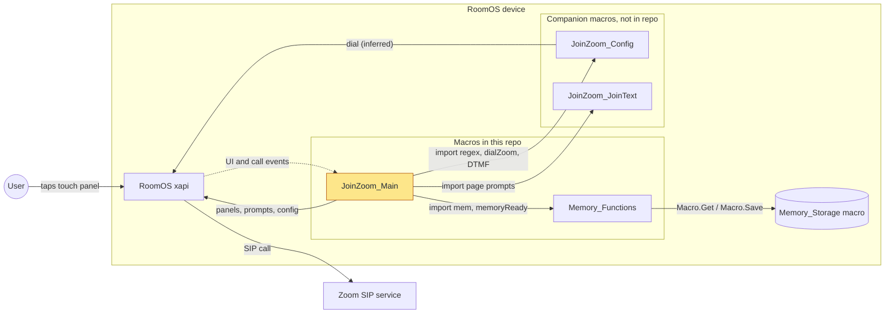
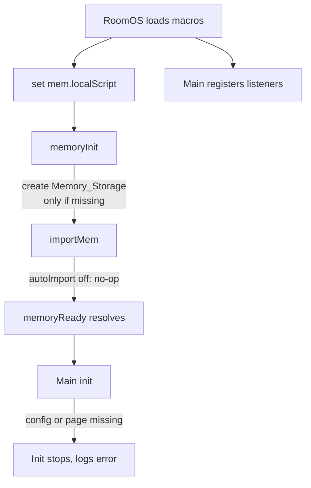
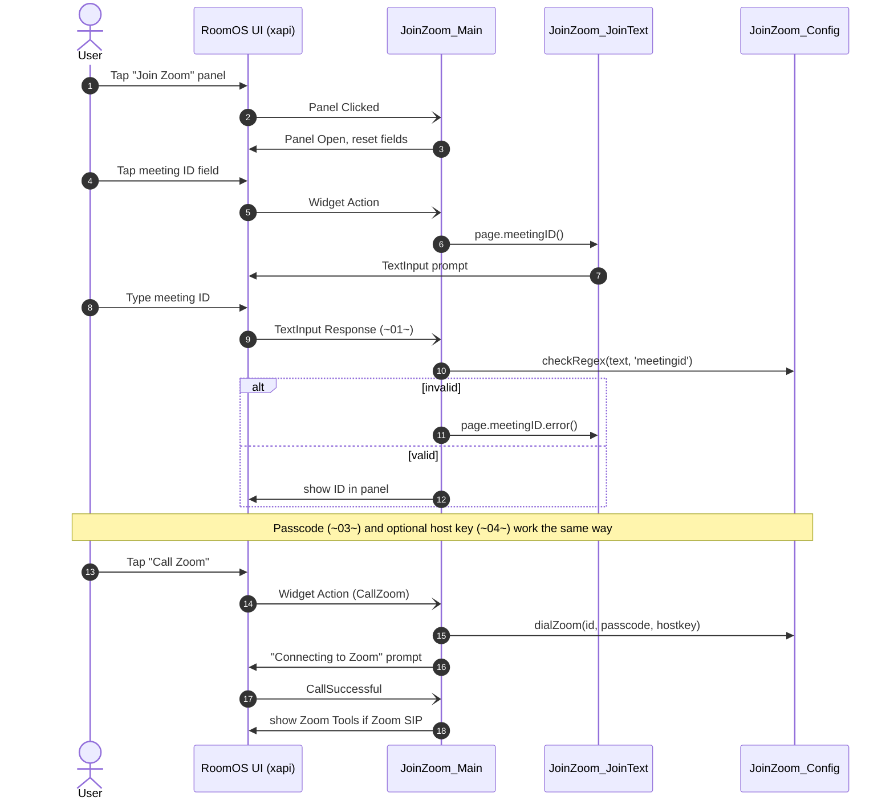

# Join-Zoom Macro · QuickJS Migration Fix


Resolve the `ReferenceError: ‘module’ is not defined` error on Cisco RoomOS 11.28+ by migrating the Join Zoom macro suite from CommonJS globals to ES Modules.

> _Claude was used to polish and proof-read the code and documentation of this repository._

<details>
<summary>Status and limitations</summary>

**Project status: archived independent migration fix.** I developed this example
independently alongside my main professional work. The repository is read-only and no
longer maintained; it is a starting point to review and adapt, rather than a
ready-to-use meeting-room product. It remains available for existing deployments using
the QuickJS fix. Cisco provides native Zoom integration (OBTP, Zoom Rooms Connector);
for new deployments, see [Alternatives & Successors](#alternatives--successors).

**Disclaimer.** Compatibility and call behavior depend on your devices, software and
companion macros. Test your deployment before operational use; responsibility for
deployment and use remains with you.

</details>

## Overview

RoomOS 11.28 replaced the legacy Duktape runtime with QuickJS and removed CommonJS globals (`module`, `exports`, `require`, `__filename`, ...). Legacy macros that call `module.name` fail to load. This repo provides a safe, backward-compatible fix and a patched `Memory_Functions.js` for Join Zoom 4-1-1.

## How it works

Everything runs inside one RoomOS device. There is no server and no build: each `.js` file is a macro, RoomOS runs it, and macros talk to each other through ES-module `import` and to the device through the `xapi` module. The touch panel UI, the call stack and the macro store are all reached through `xapi`.

### What it is made of



`JoinZoom_Main` is the only macro with behaviour of its own: it listens for touch-panel events and moves the user through the join flow. `JoinZoom_Config` and `JoinZoom_JoinText` come from the original DevNet suite; Main imports the dial logic, regexes and settings from Config and the prompt pages from JoinText. How `dialZoom()` places the call is not in this repo, so the Config → `xapi` edge is inferred. `Memory_Functions` keeps persistent data by saving it as the source text of another macro, `Memory_Storage`.

Where in the code:

- [JoinZoom_Main_4-1-1.js](JoinZoom_Main_4-1-1.js): imports at the top, event listeners (`xapi.event.on(...)`) further down.
- [Memory_Functions.js](Memory_Functions.js): `getStore()` / `saveStore()` read and write `Memory_Storage`.

### Startup



Startup runs in order: RoomOS loads macros; Memory_Functions sets `mem.localScript` (from `import.meta.url` or `module.name` fallback), then runs `memoryInit()` (creates the Memory_Storage macro only if no macro of that name exists or the existing one is empty; existing data is never overwritten), then `importMem()` if enabled (patches other macros’ imports). When the `memoryReady` promise resolves, JoinZoom_Main’s `init()` runs: it validates config and page, sleeps 5s, registers call detection and Zoom Tools visibility, applies JoinWebex config, and reads or initializes PMI. If `memoryReady` rejects (for example, the macro list cannot be read), `init()` fails and logs `init failed`.

Event listeners (Panel Clicked, TextInput, Prompt, Widget Action, CallDisconnect) are registered at load; they ignore events until the companion `config` and `page` are usable, so they can already fire while `init()` is still waiting. Call detection is armed by `init()`. If init validation fails, `init()` logs the problem and stops; there is no automatic retry. Fix the companion config and restart the macros.

Where in the code:

- [Memory_Functions.js](Memory_Functions.js): `applyLocalScriptName()`, `memoryInit()`, `importMem()`, and `memoryReady` at the bottom.
- [JoinZoom_Main_4-1-1.js](JoinZoom_Main_4-1-1.js): `init()` and the `init().then(...)` call below it.

### Joining a meeting

This is the "new" panel style (`config.ui.settings.style === 'new'`); the classic style runs the same checks through a chain of prompts instead of panel widgets.



Steps 1–3 open the panel; steps 4–12 repeat per field until `checkRegex()` accepts the input, so an invalid value never reaches the dialer. Meeting ID, passcode and host key are held in memory only, Base64-encoded (not encrypted), in `meetingInfo`. After the call connects (step 17), `detectCall()` matches the remote number against `config.regex.zoom_SIP` and shows the DTMF Zoom Tools panel; on `CallDisconnect` the state is cleared and, with `securityMode` on, Zoom entries are removed from call history.

Where in the code ([JoinZoom_Main_4-1-1.js](JoinZoom_Main_4-1-1.js)):

- `Panel Clicked` listener and `openNewStylePanel()`: steps 1–3.
- `UserInterface Extensions Widget Action` listener: field taps and `~HostKey~CallZoom`.
- `UserInterface Message TextInput Response` listener: the `'01'`, `'03'`, `'04'` cases.
- `detectCall()`, `showConnectingPrompt()` and the `CallDisconnect` listener.

### What is stored

Personal Meeting (PMI) data is the only thing `JoinZoom_Main` writes to persistent storage. It goes through the scoped memory API; every operation is one read-modify-write of the whole `Memory_Storage` macro, queued so operations from the same module instance never interleave.


| Key in `Memory_Storage` | Holds | Written by |
| --- | --- | --- |
| `./_$Info` | usage notes for humans | `memoryInit()` on first creation |
| `<macro name>` (e.g. `JoinZoom_Main_4-1-1`) | that macro's scoped keys; for Main, `btoa('PMIInfo')` → Base64 meeting ID, passcode, host key | `mem.for(name).write/update` |
| any other top-level key | global values | `mem.write.global` |

The file is stored as `var memory = {...};` and read back by taking the text between the first `{` and the last `}`. With `personalMode` off, `init()` deletes Main's whole scope from the store.

Where in the code ([Memory_Functions.js](Memory_Functions.js)): `enqueue()`, `withScope()`, `updateScoped()`, `parseStoreFromMacroContent()`; in [JoinZoom_Main_4-1-1.js](JoinZoom_Main_4-1-1.js): `PMI_KEYS`, `updatePmiField()`.

### Code map

| Path | Responsibility |
| --- | --- |
| [JoinZoom_Main_4-1-1.js](JoinZoom_Main_4-1-1.js) | UI event handling, join flow, call detection, PMI; deployed as a macro |
| [Memory_Functions.js](Memory_Functions.js) | QuickJS-safe macro name, persistent storage API, optional auto-import; deployed as a macro |
| [eslint.config.js](eslint.config.js) | Lint rules that mimic the RoomOS runtime (allowed globals, `xapi`/sibling imports only) |
| [package.json](package.json) | Dev-only lint tooling (`npm run lint`, `npm run smoke`) |
| [.github/workflows/ci.yml](.github/workflows/ci.yml) | Secret scan, lint and `npm audit` (manual or Dependabot PRs) |
| [.github/workflows/codeql.yml](.github/workflows/codeql.yml) | CodeQL security scan |

## Features

- Targets RoomOS ≤ 11.27 (Duktape) and ≥ 11.28 (QuickJS); see the [compatibility matrix](#compatibility-matrix).
- Universal replacement for `module.name` using `import.meta.url`.
- Optional scoped memory API so concurrent macros do not overwrite each other's `mem.localScript`.
- Storage writes are serialized, so concurrent writes from one macro do not lose data.
- Offline lint that enforces the RoomOS macro runtime constraints.

## Requirements

- Cisco RoomOS macros environment for deployment.
- Node.js 22.15+ for local linting (development only; nothing is built or bundled).
- Companion macros `JoinZoom_Config_4-1-1` and `JoinZoom_JoinText_4-1-1` (not included here; see [Required companion macros](#required-companion-macros-not-included-in-this-repo)).

## Quickstart

1. Copy `Memory_Functions.js` and `JoinZoom_Main_4-1-1.js` from this repo into the Macro Editor on your Cisco device (these already contain the fix).
2. Ensure companion macros `JoinZoom_Config_4-1-1` and `JoinZoom_JoinText_4-1-1` are installed.
3. Search any **other** macros in your deployment for `module.name` and replace with the [universal snippet](#universal-replacement-snippet) below.
4. Restart all macros.
5. Verify the UI loads and no `ReferenceError` appears in the Macro Editor console.

## Universal replacement snippet

```js
/* Sets mem.localScript in every firmware version */
mem.localScript = (typeof import.meta !== 'undefined' && import.meta.url)
  ? import.meta.url.split('/').pop().replace(/\.js$/i, '')      // QuickJS / ES Modules
  : (typeof module !== 'undefined' && module.name)              // legacy Duktape
  || 'UnknownScript';                                           // final fallback
```

## Optional: scoped memory API (recommended)

When multiple macros run concurrently, a shared `mem.localScript` can be overwritten. Use a scoped instance:

```js
import { mem, localScriptNameFrom } from './Memory_Functions';

const localScriptName = localScriptNameFrom({
  importMetaUrl: (typeof import.meta !== 'undefined' && import.meta.url) ? import.meta.url : undefined,
  moduleName: (typeof module !== 'undefined' && module.name) ? module.name : undefined
});

const localMem = mem.for(localScriptName);
// use localMem.read/write/remove instead of mem.read/write/remove
// read-modify-write in one step; the updater must be synchronous
// (rejects if the key does not exist yet or the updater returns a promise):
await localMem.update('counter', (n) => n + 1);
```

Storage writes are queued inside the `Memory_Functions` module instance. If your RoomOS version gives each importing macro its own module instance, writes from *different* macros can still race, because each write replaces the whole `Memory_Storage` document.

## Required companion macros (not included in this repo)

`JoinZoom_Main_4-1-1.js` depends on two macros that are not bundled here:

- `JoinZoom_Config_4-1-1`
- `JoinZoom_JoinText_4-1-1`

These are part of the original Cisco DevNet Join Zoom macro suite. Download them from the same source as the original macro bundle before deploying. Without them, `JoinZoom_Main_4-1-1.js` will fail to load.

## What was patched (already applied in this repo)

| File                     | Changes applied |
| ------------------------ | ------- |
| `Memory_Functions.js`    | Replaced `mem.localScript = module.name;` with the universal snippet; added scoped memory API (`mem.for`, including atomic `update`); storage operations are serialized; `Memory_Storage` is created only when it does not exist or is empty. |
| `JoinZoom_Main_4-1-1.js` | Replaced `module.name` usage with `localScriptNameFrom()`; updated `mem.remove.global()` to use `localScriptName`; personal meeting fields are updated atomically. |
| Any other macro in your deployment | You must replace all remaining `module.name` references with the universal snippet yourself. |

## Compatibility matrix

| Firmware                         | Patched macros | Result |
| -------------------------------- | -------------- | ------ |
| RoomOS ≤ 11.27 (Duktape)         | ✅              | Reported to work (falls back to `module.name`); not verified by this repo |
| RoomOS 11.28+ (QuickJS)          | ✅              | Works (uses `import.meta.url`) |
| Any firmware                     | ❌              | Fails with `ReferenceError` |

## Configuration

- `Memory_Functions.js` supports `config.autoImport` to inject required imports into other macros. Only the missing pieces (`import xapi`, `import { mem }`, the `mem.localScript` assignment) are added, right after an `import xapi` line that opens the macro or otherwise at the very top; existing code is never removed. Detection errs towards "already present" (any `import … xapi … from 'xapi'` text, even in a comment) so a second binding is never created.
- `JoinZoom_Main_4-1-1.js` configuration lives in `JoinZoom_Config_4-1-1` (external).

## Alternatives & Successors

> This project is archived. Consider these actively maintained alternatives:

| Project | Description | Link |
|---------|-------------|------|
| Cisco OBTP | Native One Button to Push integration via Hybrid Calendar | [Cisco Docs](https://www.cisco.com/c/en/us/td/docs/voice_ip_comm/cloudCollaboration/spark/hybridservices/calendarservice) |
| Zoom Rooms Connector | Official Zoom integration for Cisco endpoints | [Zoom Support](https://support.zoom.us/hc/en-us/articles/360023724531) |
| Webex Zoom CRC | Cloud-registered Cisco devices with Zoom interop | [Webex](https://www.webex.com) |

## Development

```bash
npm ci        # install lint tooling
npm run lint  # ESLint: macros may use only RoomOS globals and import only 'xapi' and sibling macros
npm run smoke # lint (the CI gate, together with npm audit)
```

There is no build step: the two macro files at the repository root are deployed as-is, and each file name is the macro name on the device.

## Security

- Quality CI runs the basic secret scan, lint and `npm audit` only for Dependabot-authored PRs or manual dispatch. CodeQL is a separate security-only workflow that may run on pushes, PRs, its schedule or manual dispatch. Archived GitHub execution and code-scanning availability remain separate constraints.
- Do not log or paste sensitive values (meeting IDs, host keys, phone numbers).
- Report vulnerabilities via `SECURITY.md`.

## Troubleshooting

- `ReferenceError: 'module' is not defined`: ensure the universal snippet replaced all `module.name` references.
- `JoinZoom_Main_4-1-1.js` fails to load: install the companion macros listed above.

## Credits

- Robert McGonigle Jr — original Join-Zoom macros
- Zacharie Gignac — Memory Functions utility
- Migration patch & README by Sebastian J. Spicker (May 2025)

## License

This documentation follows the same license as the original project. See `LICENSE` for details.
