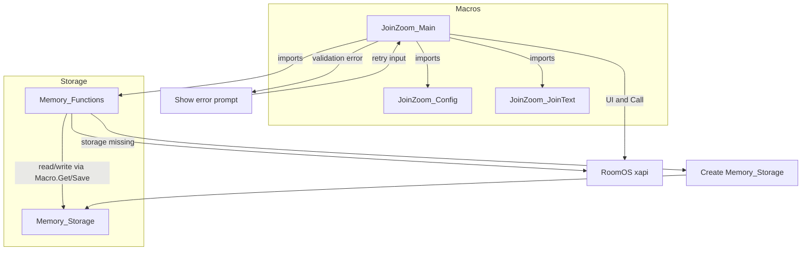
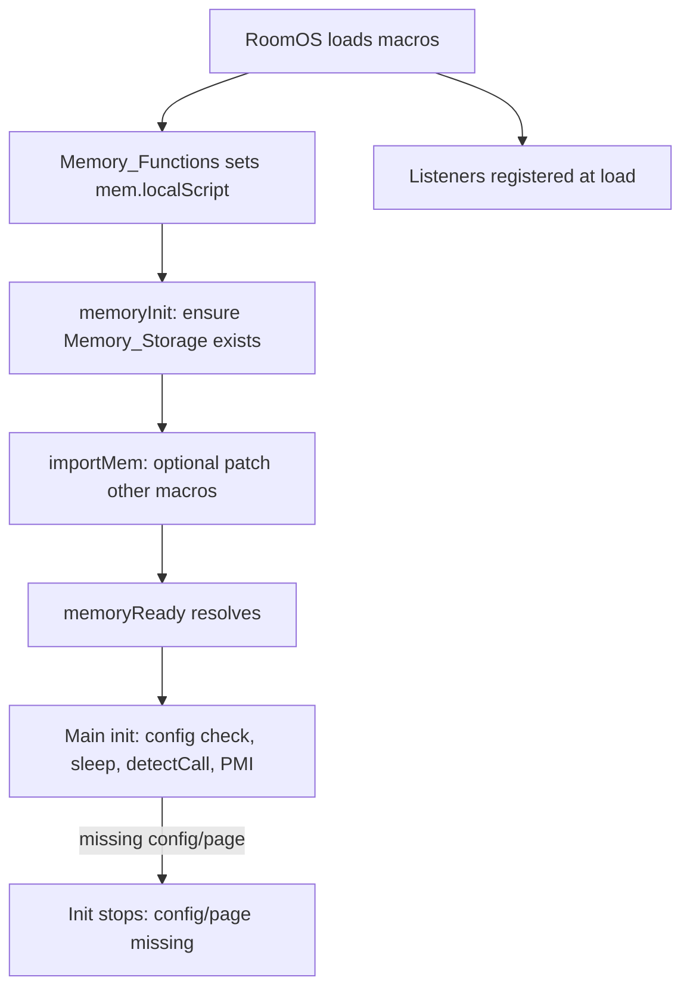

# Join-Zoom Macro · QuickJS Migration Fix

> **ARCHIVED** -- This repository is read-only and no longer maintained. Cisco now provides native Zoom integration (OBTP, Zoom Rooms Connector) for RoomOS devices. For new deployments, use [Cisco’s native Zoom integration](#alternatives--successors) instead. It remains available for existing deployments that still rely on the QuickJS migration fix.

Resolve the `ReferenceError: ‘module’ is not defined` error on Cisco RoomOS 11.28+ by migrating the Join Zoom macro suite from CommonJS globals to ES Modules.

## Overview

RoomOS 11.28 replaced the legacy Duktape runtime with QuickJS and removed CommonJS globals (`module`, `exports`, `require`, `__filename`, ...). Legacy macros that call `module.name` fail to load. This repo provides a safe, backward-compatible fix and a patched `Memory_Functions.js` for Join Zoom 4-1-1.

## How it works

The Join Zoom macro suite is made of several pieces: the main macro drives the UI and call flow; the Config macro supplies dial logic, regex, and settings; the JoinText macro supplies prompts and copy; Memory_Functions provides scoped and global persistent storage; and the Memory_Storage macro (created by Memory_Functions if missing) holds the stored data. The main macro imports Config, JoinText, and Memory_Functions, and uses the RoomOS `xapi` for UI and placing calls.



The main macro imports config/text/memory helpers and drives RoomOS UI plus call placement through `xapi`. Validation errors (meeting ID, passcode, or role) stay in the prompt flow until corrected, instead of proceeding to dial. `Memory_Storage` is created only at startup and only if it does not exist; later storage errors are reported to the caller and never trigger a rewrite of existing data.

## Lifecycle

Startup runs in order: RoomOS loads macros; Memory_Functions sets `mem.localScript` (from `import.meta.url` or `module.name` fallback), then runs `memoryInit()` (creates the Memory_Storage macro only if no macro of that name exists; existing data is never overwritten), then `importMem()` if enabled (patches other macros’ imports). When the `memoryReady` promise resolves, JoinZoom_Main’s `init()` runs: it validates config and page, sleeps 5s, registers call detection and Zoom Tools visibility, applies JoinWebex config, and reads or initializes PMI. Event listeners (Panel Clicked, TextInput, Prompt, Widget Action, CallDisconnect) are registered at load; they ignore events until the companion `config` and `page` are usable, so they can already fire while `init()` is still waiting. Call detection is armed by `init()`.



If init validation fails, `init()` logs the problem and stops; there is no automatic retry. Fix the companion config and restart the macros. During runtime, panel and prompt events gather meeting info; widget actions trigger `dialZoom()`, and disconnect events reset state for the next call.

## Features

- Targets RoomOS ≤ 11.27 (Duktape) and ≥ 11.28 (QuickJS); see the [compatibility matrix](#compatibility-matrix).
- Universal replacement for `module.name` using `import.meta.url`.
- Optional scoped memory API so concurrent macros do not overwrite each other's `mem.localScript`.
- Storage writes are serialized, so concurrent writes from one macro do not lose data.
- Offline lint that enforces the RoomOS macro runtime constraints.

## Requirements

- Cisco RoomOS macros environment for deployment.
- Node.js 22.15+ for local linting (development only; nothing is built or bundled).
- Companion macros `JoinZoom_Config_4-1-1` and `JoinZoom_JoinText_4-1-1` (not included here; see [Required companion macros](#required-companion-macros-not-included-in-this-repo)).

## Quickstart

1. Copy `Memory_Functions.js` and `JoinZoom_Main_4-1-1.js` from this repo into the Macro Editor on your Cisco device (these already contain the fix).
2. Ensure companion macros `JoinZoom_Config_4-1-1` and `JoinZoom_JoinText_4-1-1` are installed.
3. Search any **other** macros in your deployment for `module.name` and replace with the [universal snippet](#universal-replacement-snippet) below.
4. Restart all macros.
5. Verify the UI loads and no `ReferenceError` appears in the Macro Editor console.

## Universal replacement snippet

```js
/* Sets mem.localScript in every firmware version */
mem.localScript = (typeof import.meta !== 'undefined' && import.meta.url)
  ? import.meta.url.split('/').pop().replace(/\.js$/i, '')      // QuickJS / ES Modules
  : (typeof module !== 'undefined' && module.name)              // legacy Duktape
  || 'UnknownScript';                                           // final fallback
```

## Optional: scoped memory API (recommended)

When multiple macros run concurrently, a shared `mem.localScript` can be overwritten. Use a scoped instance:

```js
import { mem, localScriptNameFrom } from './Memory_Functions';

const localScriptName = localScriptNameFrom({
  importMetaUrl: (typeof import.meta !== 'undefined' && import.meta.url) ? import.meta.url : undefined,
  moduleName: (typeof module !== 'undefined' && module.name) ? module.name : undefined
});

const localMem = mem.for(localScriptName);
// use localMem.read/write/remove instead of mem.read/write/remove
// read-modify-write in one step; the updater must be synchronous
// (rejects if the key does not exist yet or the updater returns a promise):
await localMem.update('counter', (n) => n + 1);
```

Storage writes are queued inside the `Memory_Functions` module instance. If your RoomOS version gives each importing macro its own module instance, writes from *different* macros can still race, because each write replaces the whole `Memory_Storage` document.

## Required companion macros (not included in this repo)

`JoinZoom_Main_4-1-1.js` depends on two macros that are not bundled here:

- `JoinZoom_Config_4-1-1`
- `JoinZoom_JoinText_4-1-1`

These are part of the original Cisco DevNet Join Zoom macro suite. Download them from the same source as the original macro bundle before deploying. Without them, `JoinZoom_Main_4-1-1.js` will fail to load.

## What was patched (already applied in this repo)

| File                     | Changes applied |
| ------------------------ | ------- |
| `Memory_Functions.js`    | Replaced `mem.localScript = module.name;` with the universal snippet; added scoped memory API (`mem.for`, including atomic `update`); storage operations are serialized; `Memory_Storage` is created only when it does not exist. |
| `JoinZoom_Main_4-1-1.js` | Replaced `module.name` usage with `localScriptNameFrom()`; updated `mem.remove.global()` to use `localScriptName`; personal meeting fields are updated atomically. |
| Any other macro in your deployment | You must replace all remaining `module.name` references with the universal snippet yourself. |

## Compatibility matrix

| Firmware                         | Patched macros | Result |
| -------------------------------- | -------------- | ------ |
| RoomOS ≤ 11.27 (Duktape)         | ✅              | Reported to work (falls back to `module.name`); not verified by this repo |
| RoomOS 11.28+ (QuickJS)          | ✅              | Works (uses `import.meta.url`) |
| Any firmware                     | ❌              | Fails with `ReferenceError` |

## Configuration

- `Memory_Functions.js` supports `config.autoImport` to inject required imports into other macros. Only the missing pieces (`import xapi`, `import { mem }`, the `mem.localScript` assignment) are added, right after an `import xapi` line that opens the macro or otherwise at the very top; existing code is never removed. Detection errs towards "already present" (any `import … xapi … from 'xapi'` text, even in a comment) so a second binding is never created.
- `JoinZoom_Main_4-1-1.js` configuration lives in `JoinZoom_Config_4-1-1` (external).

## Alternatives & Successors

> This project is archived. Consider these actively maintained alternatives:

| Project | Description | Link |
|---------|-------------|------|
| Cisco OBTP | Native One Button to Push integration via Hybrid Calendar | [Cisco Docs](https://www.cisco.com/c/en/us/td/docs/voice_ip_comm/cloudCollaboration/spark/hybridservices/calendarservice) |
| Zoom Rooms Connector | Official Zoom integration for Cisco endpoints | [Zoom Support](https://support.zoom.us/hc/en-us/articles/360023724531) |
| Webex Zoom CRC | Cloud-registered Cisco devices with Zoom interop | [Webex](https://www.webex.com) |

## Development

```bash
npm ci        # install lint tooling
npm run lint  # ESLint: macros may use only RoomOS globals and import only 'xapi' and sibling macros
npm run smoke # lint (the CI gate, together with npm audit)
```

There is no build step: the two macro files at the repository root are deployed as-is, and each file name is the macro name on the device.

## Security

- CI runs a basic secret scan, `npm audit`, and CodeQL SAST.
- Do not log or paste sensitive values (meeting IDs, host keys, phone numbers).
- Report vulnerabilities via `SECURITY.md`.

## Troubleshooting

- `ReferenceError: 'module' is not defined`: ensure the universal snippet replaced all `module.name` references.
- `JoinZoom_Main_4-1-1.js` fails to load: install the companion macros listed above.

## Credits

- Robert McGonigle Jr — original Join-Zoom macros
- Zacharie Gignac — Memory Functions utility
- Migration patch & README by Sebastian J. Spicker (May 2025)

## License

This documentation follows the same license as the original project. See `LICENSE` for details.
